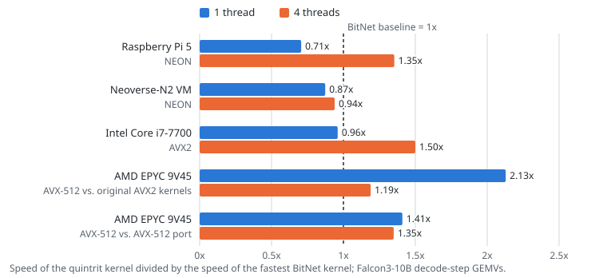
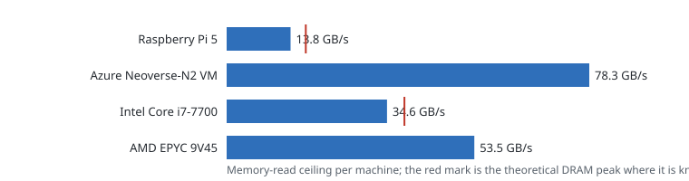

# Benchmarks

This page compares the quintrit kernels with the kernels of Microsoft BitNet on the same machines (first part) and
gives the memory-bandwidth ceiling of every machine, which explains where each encoding wins (second part).

## Kernel comparison: quintrit versus BitNet

### What is compared

| Kernel | Encoding | Instruction set | What it is |
|---|---|---|---|
| `quintrit` | 5 trits per byte, 1.60 bits per weight (velurex encoding) | AVX2, NEON | The activation-table kernel of this SDK |
| `quintrit_512` | 5 trits per byte, 1.60 bits per weight | AVX-512 (VBMI, VNNI) | The 64-row activation-table kernel of this SDK |
| `mad` | 4 trits per byte, 2.00 bits per weight (`I2_S`) | AVX2, NEON | BitNet's planar multiply-add kernel, the kernel BitNet runs for `I2_S` |
| `lut` | 4 trits per byte, 2.00 bits per weight | AVX2, NEON | BitNet's 32-row tiled pair-table lookup kernel over the same weights, with BitNet's original activation handling (63 levels) |
| `mad512` | 4 trits per byte, 2.00 bits per weight | AVX-512 | The `mad` algorithm widened to 512-bit registers. BitNet has no AVX-512 kernel; this port exists so that `quintrit_512` can also be compared on the same instruction set |

The BitNet kernels are faithful Rust transcriptions of the C++ kernels of BitNet; they are the Rust-only crate
[`quintrit-bitnet`](../rust/crates/quintrit-bitnet/README.md), which is not part of the C library or the Python package.
They are measured as transcribed, with no tuning. Every kernel runs in the same harness, on the same machine, over the
same matrix shapes.

### Baseline and relative speed

For every machine and thread count, the **baseline** is the fastest BitNet kernel available for the comparison, and

```text
relative speed = Gweights/s of the quintrit kernel / Gweights/s of the baseline
```

A value above 1 means that the quintrit kernel is faster.

- **NEON (Raspberry Pi 5, Neoverse-N2) and AVX2 (i7-7700):** the baseline is `mad`, the kernel BitNet runs for its
  `I2_S` format on these instruction sets.
- **AVX-512 (AMD EPYC 9V45):** `quintrit_512` is compared twice.
  1. Against the faster of BitNet's original kernels `mad` and `lut`. Both are AVX2 kernels, because BitNet ships
     nothing for AVX-512, so this is the speed that BitNet's own kernels reach on this machine.
  2. Against `mad512`, the same BitNet algorithm on the same instruction set. This comparison isolates the encoding.

  The AVX2 `quintrit` kernel against the same baseline is listed in the table for completeness. It is not shown in
  the chart.

### Method

- **Workload:** the weight-streaming pattern of one decode step of Falcon3-10B: the seven projections of every
  layer (q, k, v, o, gate, up, down; K = 3072 and 23040) in model order, with random valid weights. One pass reads
  more than 1 GB of weights, so the weights come from DRAM and not from cache.
- **Rate:** Gweights/s over the whole pass. The value is the best of 9 repetitions, averaged over two rounds, and the
  second round runs the kernels in the reverse order.
- **Execution:** the SDK's parallel GEMV in the call structure of the inference engine (a persistent thread pool and
  concurrent projections within a group). Runs with free-running pinned threads give ratios within a few hundredths
  of these.
- **Threads:** 1 and 4. On the EPYC VM, four threads are two physical cores with their SMT siblings.
- **Correctness first:** before every measurement, the SDK tests passed on the machine. The runtime's 256 greedy
  tokens and the checked logits of Falcon3-10B-Instruct-1.58bit were also bit-identical to the BitNet reference
  runtime.
- **Share of the memory ceiling:** the GB/s of the kernel's own weight bytes (2.00 or 1.60 bits per weight) divided
  by the read-only memory ceiling of the same machine at the same thread count, measured in the same session. The
  smaller format therefore reaches a higher weight rate at the same share.

### Results

<!-- kernels:begin -->


| Machine | Comparison | Threads | BitNet kernels, Gweights/s | Baseline | Quintrit kernel, Gweights/s | Relative speed | Share of the memory ceiling, baseline / quintrit |
|---|---|---:|---|---|---|---:|---|
| Raspberry Pi 5 | NEON | 1 | `mad` 24.5 | `mad` | `quintrit` 17.3 | **0.71x** | 44 % / 25 % |
| Raspberry Pi 5 | NEON | 4 | `mad` 40.7 | `mad` | `quintrit` 55.1 | **1.35x** | 84 % / 91 % |
| Neoverse-N2 VM | NEON | 1 | `mad` 35.2 | `mad` | `quintrit` 30.7 | **0.87x** | 43 % / 30 % |
| Neoverse-N2 VM | NEON | 4 | `mad` 121.0 | `mad` | `quintrit` 113.6 | **0.94x** | 39 % / 29 % |
| Intel Core i7-7700 | AVX2 | 1 | `mad` 46.0 | `mad` | `quintrit` 44.2 | **0.96x** | 47 % / 36 % |
| Intel Core i7-7700 | AVX2 | 4 | `mad` 97.9 | `mad` | `quintrit` 146.9 | **1.50x** | 71 % / 85 % |
| AMD EPYC 9V45 | AVX-512 vs. original AVX2 kernels | 1 | `mad` 86.7, `lut` 64.5 | `mad` | `quintrit_512` 184.4 | **2.13x** | 48 % / 83 % |
| AMD EPYC 9V45 | AVX-512 vs. original AVX2 kernels | 4 | `mad` 186.2, `lut` 155.1 | `mad` | `quintrit_512` 221.6 | **1.19x** | 87 % / 83 % |
| AMD EPYC 9V45 | AVX-512 vs. AVX-512 port | 1 | `mad512` 130.8 | `mad512` | `quintrit_512` 184.4 | **1.41x** | 73 % / 83 % |
| AMD EPYC 9V45 | AVX-512 vs. AVX-512 port | 4 | `mad512` 164.2 | `mad512` | `quintrit_512` 221.6 | **1.35x** | 76 % / 83 % |
| AMD EPYC 9V45 | AVX2 vs. original AVX2 kernels | 1 | `mad` 86.7, `lut` 64.5 | `mad` | `quintrit` 64.3 | 0.74x | 48 % / 29 % |
| AMD EPYC 9V45 | AVX2 vs. original AVX2 kernels | 4 | `mad` 186.2, `lut` 155.1 | `mad` | `quintrit` 143.9 | 0.77x | 87 % / 54 % |
<!-- kernels:end -->

### Reading the results

The velurex encoding reads 20 % fewer weight bytes but needs more work to decode a byte. Which of the two effects
decides depends on how close the BitNet kernel already is to the memory ceiling of the machine.

- **Memory-bound: quintrit is faster.** With four threads on the Raspberry Pi 5 (1.35x) and on the i7-7700 (1.50x),
  `mad` runs at 84 % and 71 % of the memory ceiling. The smaller format passes through the same memory system faster,
  and `quintrit` reaches 91 % and 85 % of the ceiling.
- **AVX-512: faster at both thread counts.** With AVX-512, `quintrit_512` decodes about as many weights per cycle as
  `mad512` (58-65 against 59-64 with cache-resident weights). The smaller stream therefore shows directly: 1.41x
  (one thread) and 1.35x (four threads) on the same instruction set. Against BitNet's own kernels, where `mad` is
  faster than `lut` on this machine, the gain is 2.13x on one core. With four threads it is 1.19x, because `mad`
  is then already at 87 % of the ceiling. On this two-core VM, `mad512` is slower than `mad` with four threads,
  which is why the two comparisons differ.
- **Compute-bound: quintrit is slower.** One Cortex-A76 core decodes the 5-trit code at about 60 % of the `mad`
  weight rate (7.5 against 12.3 weights per cycle), so one thread on the Raspberry Pi 5 gives 0.71x. The
  Neoverse-N2 VM has bandwidth to spare: both kernels stay below 45 % of its ceiling, so the smaller format cannot
  help (0.87x and 0.94x). The AVX2 `quintrit` kernel on the EPYC machine reaches 0.74x and 0.77x. AVX2 is not
  developed further; the AVX-512 kernel is the one to use on this processor.
- **i7-7700, one thread:** the `mad` rate alternates between two levels (about 36 and 46 Gweights/s) within the same
  run. Against the higher level the ratio is 0.96x, and with pinned threads it is 1.14x. Read it as roughly equal.

These are kernel rates. A whole generated token also runs the F16 output projection, which is the same for both
encodings and takes 13-30 % of a token, plus attention and normalization. Ratios per token therefore lie closer to 1
than the kernel ratios. The BitNet kernels are not part of the inference engine of this SDK, so this page gives
no token-level comparison.

## Memory ceiling

### Method: the memory ceiling first

Generating a token reads every ternary weight of the model once. On the CPUs this software targets, that read is limited
by the memory system and not by arithmetic, so a kernel is judged against what the memory can deliver. Every benchmark
therefore starts with the **bandwidth ceiling** of the machine: a read-only stream over a buffer much larger than the
last-level cache, with a sweep over the number of threads.

The ceiling gives an upper bound for the speed of a decode step:

```text
tokens per second  ≤  memory bandwidth / bytes of ternary weights read per token
bytes per weight   =  0.20  (1.60 bits)   for velurex encoding
                      0.25  (2.00 bits)   for I2_S
```

For every billion ternary weights, a token reads 200 MB (velurex encoding) or 250 MB (`I2_S`). With the ceilings
measured below this bounds the decode speed as follows. These are upper bounds that ignore the attention, the
embeddings and the other layers, not measurements.

<!-- bounds:begin -->
| Machine | Ceiling | Bound per billion weights, 1.60 bpw | Bound, 2.00 bpw |
|---|---:|---:|---:|
| Raspberry Pi 5 (Cortex-A76, 4 cores) | 13.81 GB/s | 69 tokens/s | 55 tokens/s |
| Azure Neoverse-N2 VM (4 vCPU) | 78.31 GB/s | 392 tokens/s | 313 tokens/s |
| Intel Core i7-7700 | 34.63 GB/s | 173 tokens/s | 139 tokens/s |
| AMD EPYC 9V45 (Azure VM, 2 cores x 2 threads) | 53.48 GB/s | 267 tokens/s | 214 tokens/s |
<!-- bounds:end -->

The ratio between the two columns is the 25 % more tokens per second that 20 % less traffic allows.

### Ceilings per machine

Read-only streaming bandwidth, measured with rustc 1.99.1, a 1 GiB buffer (much larger
than the last-level cache), 21 repetitions per point with one discarded warm-up, threads pinned to cores (physical cores first).
Rates are decimal GB/s (10^9 bytes/s). The ceiling is the best rate of the thread sweep.

<!-- results:begin -->


#### Raspberry Pi 5 (Cortex-A76, 4 cores)

4 cores, 2.0 MiB last-level cache, 8 GB LPDDR4X-4267, 32-bit bus, theoretical 17.1 GB/s.

Ceiling **13.81 GB/s** with 1 thread (81 % of the theoretical peak). Kernel: NEON loads; `-C target-cpu=cortex-a76`; rustc 1.99.1.

| Threads | Best | Median | Share of the theoretical peak (best) | Note |
|---:|---:|---:|---:|---|
| 1 | 13.81 | 13.79 | 81 % |  |
| 2 | 13.26 | 13.13 | 78 % |  |
| 3 | 12.70 | 12.61 | 74 % |  |
| 4 | 12.15 | 12.09 | 71 % |  |

#### Azure Neoverse-N2 VM (4 vCPU)

4 cores, 128.0 MiB last-level cache.

Ceiling **78.31 GB/s** with 4 threads. Kernel: NEON loads; `-C target-cpu=neoverse-n2`; rustc 1.99.1.

| Threads | Best | Median | Note |
|---:|---:|---:|---|
| 1 | 20.27 | 19.33 |  |
| 2 | 38.45 | 37.43 |  |
| 3 | 56.40 | 53.70 |  |
| 4 | 78.31 | 73.53 |  |

#### Intel Core i7-7700

4 cores, 8.0 MiB last-level cache, 16 GB + 8 GB DDR4-2400 (Kingston), one DIMM per channel (dual channel), theoretical 38.4 GB/s.

Ceiling **34.63 GB/s** with 4 threads (90 % of the theoretical peak). Kernel: AVX2 loads; `-C target-cpu=skylake`; rustc 1.99.1.

| Threads | Best | Median | Share of the theoretical peak (best) | Note |
|---:|---:|---:|---:|---|
| 1 | 24.45 | 24.44 | 64 % |  |
| 2 | 33.95 | 33.57 | 88 % |  |
| 3 | 34.06 | 33.60 | 89 % |  |
| 4 | 34.63 | 34.47 | 90 % |  |
| 5 | 33.22 | 32.83 | 87 % | SMT siblings in use |
| 6 | 33.33 | 33.21 | 87 % | SMT siblings in use |
| 7 | 33.58 | 33.34 | 87 % | SMT siblings in use |
| 8 | 33.57 | 33.33 | 87 % | SMT siblings in use |

#### AMD EPYC 9V45 (Azure VM, 2 cores x 2 threads)

2 cores, 32.0 MiB last-level cache.

Ceiling **53.48 GB/s** with 4 threads. Kernel: AVX-512 loads; `-C target-cpu=znver4`; rustc 1.99.1.

| Threads | Best | Median | Note |
|---:|---:|---:|---|
| 1 | 43.48 | 43.31 |  |
| 2 | 52.39 | 51.70 |  |
| 3 | 50.19 | 49.98 | SMT siblings in use |
| 4 | 53.48 | 53.02 | SMT siblings in use |
<!-- results:end -->

The benchmark programs write a full report (machine, memory
configuration, every repetition with best, median, worst and spread, and the variants: unpinned threads, software prefetch, narrower loads,
copy) to a `results/` directory next to the crate; the directory is ignored by git.

End-to-end throughput of whole models on these machines and the energy per
decoded token are measured by the benchmarks below. Their reports will be published after the measurements have been
repeated on every machine, and each will state the kernel, the instruction set, the hardware, the method and the
output parity status.

## Running the benchmarks

All commands run in [`rust/`](../rust/). Use release builds, close other work on the machine, and give every report a
`--suffix` that names the machine.

### The model

The end-to-end benchmarks (`e2e_avx2_neon_bench`, `e2e_avx512_bench`) decode a real model and **do not run without
one**: if no model is found, or the path given with `--model` does not exist, the program prints an error and exits
without writing a report. They were tested with **Falcon3-10B-Instruct-1.58bit**
([Hugging Face: `tiiuae/Falcon3-10B-Instruct-1.58bit-GGUF`](https://huggingface.co/tiiuae/Falcon3-10B-Instruct-1.58bit-GGUF),
about 4 GB, file `ggml-model-i2_s.gguf`). The model is published under the Falcon LLM license; read its terms on the
model page before you use it.

This command downloads the model into the recommended folder `models/` at the root of the repository (the benchmarks
look there on their own, and the folder is not tracked by git). It needs only `curl` and about 4 GB of disk space:

```bash
mkdir -p ../models/Falcon3-10B-Instruct-1.58bit
curl -L --fail -C - \
  -o ../models/Falcon3-10B-Instruct-1.58bit/ggml-model-i2_s.gguf \
  https://huggingface.co/tiiuae/Falcon3-10B-Instruct-1.58bit-GGUF/resolve/main/ggml-model-i2_s.gguf
```

With the Hugging Face command-line tool (`pip install -U "huggingface_hub[cli]"`) the same download is
`huggingface-cli download tiiuae/Falcon3-10B-Instruct-1.58bit-GGUF ggml-model-i2_s.gguf --local-dir ../models/Falcon3-10B-Instruct-1.58bit`.

The path of the model is given with `--model <path>` (or the environment variable `QUINTRIT_MODEL_PATH`). Without either,
every benchmark that needs a model looks for `models/Falcon3-10B-Instruct-1.58bit/ggml-model-i2_s.gguf` in the crate
directory and in the directories above it, so the folder from the download command above is found on its own. A relative
path given by hand is resolved from the crate directory (`cargo bench` runs there), so the commands below use an
absolute path:

```bash
MODEL="$PWD/../models/Falcon3-10B-Instruct-1.58bit/ggml-model-i2_s.gguf"
```

The end-to-end benchmarks compare the encodings when they are built with the cargo feature `bitnet-baseline`, which adds
the BitNet kernels of the crate [`quintrit-bitnet`](../rust/crates/quintrit-bitnet/README.md) to the runtime: `mad` (the
kernel BitNet runs for `I2_S` weights, AVX2 and NEON) and `mad512` (its widening to AVX-512). The first kernel of a report
is its baseline: with the feature it is BitNet's `mad`, without it the benchmark compares only the instruction sets
of the quintrit kernels. All kernels run the same model and prompt and must generate identical tokens; the report
lists this check. The feature is off by default, and the C library and the Python package never enable it.

### Commands

```bash
# 1. Memory-bandwidth ceiling (read-only stream, thread sweep). Writes results/memory_bandwidth_<suffix>.md in the crate directory
cargo bench -p quintrit-core --bench memory_bandwidth -- --suffix my-machine --label "My machine"

# 2. End-to-end decoding of a whole model, 4-trit BitNet kernels against the 5-trit quintrit kernels
#    (requires the GGUF model above; thread sweep, 64 tokens)
cargo bench -p quintrit-runtime --features bitnet-baseline --bench e2e_avx2_neon_bench -- --model "$MODEL" --suffix my-machine --tokens 64   # AVX2, NEON
cargo bench -p quintrit-runtime --features bitnet-baseline --bench e2e_avx512_bench    -- --model "$MODEL" --suffix my-machine --tokens 64   # AVX-512

# 3. Energy per decoded token, BitNet's 4-trit kernel against the quintrit kernel
#    (Raspberry Pi 5 only: reads the PMIC rail telemetry of `vcgencmd pmic_read_adc`).
#    --kernel takes one or more kernels separated by commas; they are measured one after the other, the first one is the baseline.
#    Without --kernel, the benchmark compares bitnet_mad with quintrit (with the feature) or measures quintrit (without it).
cargo bench -p quintrit-runtime --features bitnet-baseline --bench token_energy -- --model "$MODEL" --kernel bitnet_mad,quintrit --threads 4 --tokens 96 --suffix my-machine
```

The energy benchmark writes one report per kernel (`token_energy_<kernel>_t<threads>_<suffix>.md`) and, for several
kernels, a comparison report (`token_energy_compare_t<threads>_<suffix>.md`): latency, power, energy per token in total
and above idle, energy per gigabyte of weights read, the energy relative to the baseline, and whether every kernel
generated the same tokens as the baseline. Energy numbers are only comparable when that check passes.

### Recording the conditions

Every report starts with a table of the conditions of the run: commit, compiler, `RUSTFLAGS`, kernel, instruction
features, threads, device and date, and whether the output matches a reference. The commit is read with `git`, and the
compiler flags and the parity status are taken from environment variables, so set them for the run; a value that is not
set appears in the report as `not recorded` or `(none)`:

```bash
export RUSTFLAGS="-C target-cpu=cortex-a76"                    # the flags you build with (example: Raspberry Pi 5)
export QUINTRIT_BENCH_COMMIT="$(git rev-parse --short HEAD)"   # needed only where the directory is not a git repository with a commit
export QUINTRIT_BENCH_PARITY="256 greedy tokens and logits identical to the reference runtime"   # the result of your own parity check
export QUINTRIT_BENCH_DEVICE="rpi5-cortex-a76"                 # optional name of the machine (default: the architecture)
```

The end-to-end reports record the same conditions and, in the table of kernels, whether the generated tokens of all
kernels are identical, so that a number cannot be separated from its conditions.

## Reading the numbers

- Compare a measured speed with the bound of the same machine, not with a number from a different machine.
- A thread sweep matters: the best thread count differs between machines (on the Raspberry Pi 5 a single core already
  reaches the ceiling), and simultaneous multithreading siblings are marked in the reports.
- Pin threads to cores for repeatable results (the benchmarks do). Unpinned runs vary more.
- Cloud virtual machines hide the memory configuration; the report says so instead of quoting a theoretical peak.
- Do not compare a speed with a different kernel unless both produce the same output. A faster kernel that changes
  the text is a different computation.
