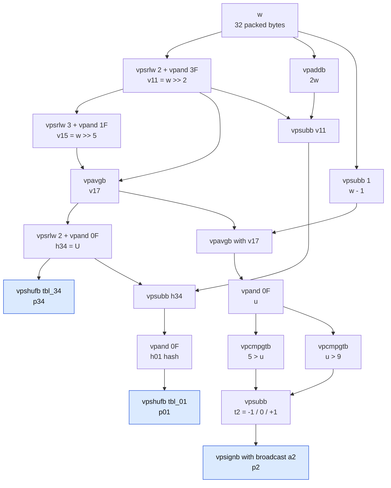
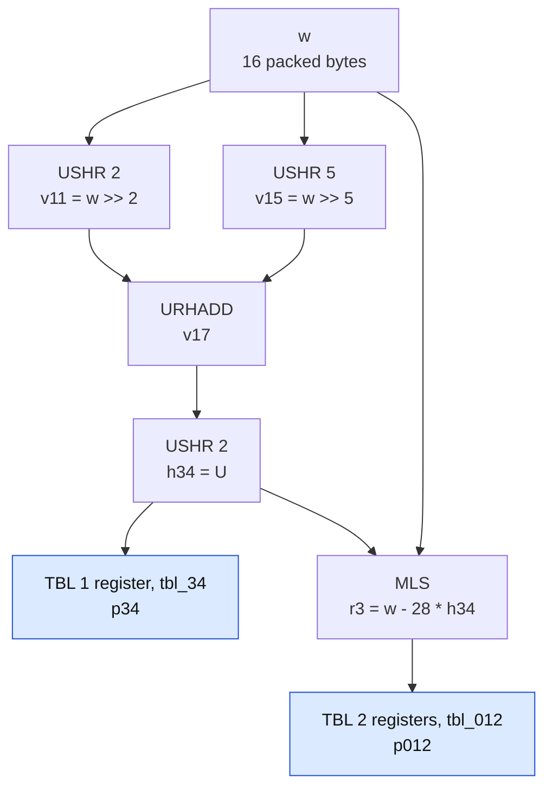
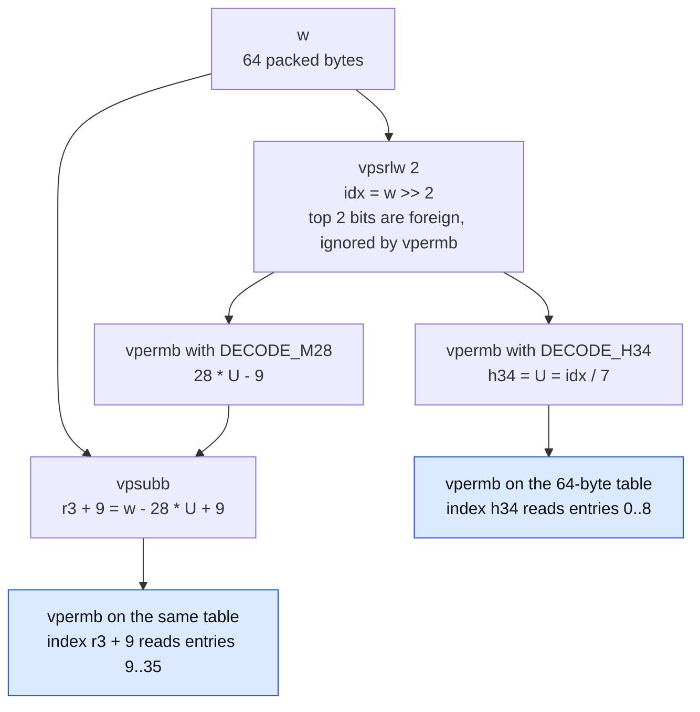
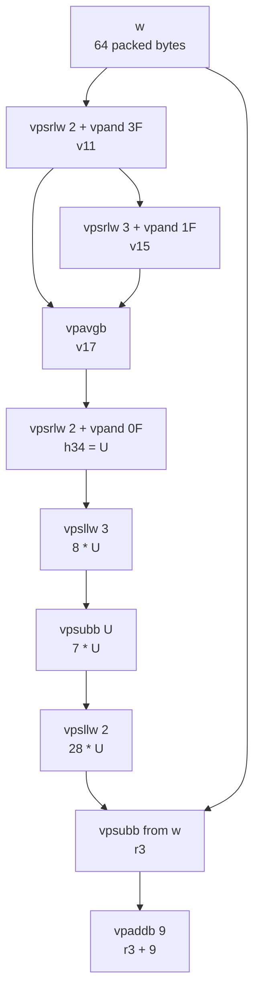

# SIMD Weight Decode: AVX2, AVX-512 and NEON

This document shows which vector instructions each supported instruction set executes to turn one packed weight byte
into table indices, and which bit tricks make each sequence short. The encoding itself (radix vector
$(1, 3, 9, 28, 84)$, why 28 is used instead of 27) is defined in [`velurex-encoding.md`](velurex-encoding.md) and is not
repeated here.

Source code of the sequences described below:

- AVX2: [`simd/avx2.rs`](../rust/crates/quintrit-core/src/simd/avx2.rs) (`decode_column`, `column_products`)
- AVX-512: [`simd/avx512.rs`](../rust/crates/quintrit-core/src/simd/avx512.rs) (`decode_compact`, `DECODE_H34`, `DECODE_M28`, `decompose_quintrit_avx512`)
- NEON: [`simd/neon.rs`](../rust/crates/quintrit-core/src/simd/neon.rs) (`eval_column_terms_32rows`)
- Lookup maps used by the activation tables: [`lut.rs`](../rust/crates/quintrit-core/src/lut.rs) (`MAP_34`, `MAP_01`, `MAP_2`, `MAP_012`)

Every formula in this document reproduces the packing definition exactly for all 243 valid bytes.

---

## 1. What every architecture has to produce

A weight byte is $w = L + 28\,U$ with $L = d_0 + 3d_1 + 9d_2 \in [0, 26]$ and $U = d_3 + 3d_4 \in [0, 8]$. The kernel never
needs the trits themselves. It needs **indices into tables of precomputed activation sums**, built once per activation
vector:

- one index for the upper pair $(d_3, d_4)$, which is $U$ (9 distinct values);
- one or more indices for the lower three trits $(d_0, d_1, d_2)$, which is $L$ (27 distinct values).

Because 28 is a multiple of 4, $U = \lfloor w / 28 \rfloor = \lfloor (w \gg 2) / 7 \rfloor$. The task is to get $U$ (and
$L$, or a substitute for it) from $w$ in as few vector operations as possible, **without an integer division, which no
SIMD instruction set offers**.

The idea is the same everywhere. What differs is the set of **building blocks** each instruction set provides:

| Building block | AVX2 | AVX-512 (BW + VBMI) | NEON (AArch64) |
|---|---|---|---|
| Per-byte shift | none (shift 16-bit lanes, then mask) | none (same) | yes (`USHR` on `.16b`) |
| Rounded byte average | `vpavgb` | `vpavgb` | `URHADD` |
| Byte table lookup | `vpshufb`: **16 entries** per 128-bit lane | `vpermb`: **64 entries**, whole register | `TBL`: 16 entries per register, up to 4 registers |
| Multiply-subtract on bytes | none | none | `MLS` |
| Index bits used by the lookup | low 4 bits (bit 7 set gives zero) | low 6 bits | whole byte (out of range gives zero) |

---

## 2. The shared trick: division by 28 from shifts and one rounded average

For one byte:

```text
v11 = w >> 2                      // w / 4
v15 = w >> 5                      // w / 32  (= v11 >> 3)
v17 = (v11 + v15 + 1) >> 1        // rounded average
U   = v17 >> 2                    // floor(w / 28)
```

Why it works: $v_{15} \approx v_{11}/8$, so $v_{17} \approx (v_{11} + v_{11}/8)/2 = \tfrac{9}{16}v_{11}$ and
$U = v_{17}/4 \approx \tfrac{9}{64}v_{11}$. The factor $9/64 = 0.1406$ is a close, slightly low approximation of
$1/7 = 0.1429$, and $U$ should be $v_{11}/7$. The `+1` of the rounding average compensates the low bias. Over the byte
range 0…250 the result equals $\lfloor w/28 \rfloor$ exactly ($w = 27 \to 0$, $w = 28 \to 1$, $w = 250 \to 8$). The
sequence uses only shifts and one average, with no multiplication.

The remainder $L = w - 28U$ is then computed (NEON, AVX-512) or avoided altogether (AVX2).

---

## 3. AVX2 (256-bit, 32 rows per register)

### Constraints that shape the design

1. **No per-byte shift.** `vpsrlw` shifts 16-bit lanes, so every shift needs a `vpand` that clears the bits pulled in from
   the neighbouring byte. Each `>>` costs two instructions.
2. **`vpshufb` has only 16 entries** (index = low 4 bits of each byte, per 128-bit lane). The 27 values of $L$ do not fit.
   The lower three trits are therefore split into $(d_0, d_1)$, 9 values that fit a 16-entry table, and $d_2$, which is
   handled arithmetically without a table.

### Instruction sequence (`decode_column` + `column_products`)

```text
v11 = and(srli_epi16(w, 2), 0x3F)          // vpsrlw, vpand        w >> 2
v15 = and(srli_epi16(v11, 3), 0x1F)        // vpsrlw, vpand        w >> 5
v17 = avg_epu8(v11, v15)                   // vpavgb
h34 = and(srli_epi16(v17, 2), 0x0F)        // vpsrlw, vpand        U            -> index of table (t3, t4)
p34 = shuffle_epi8(tbl_34, h34)            // vpshufb

h01 = and(2*w - v11 - h34, 0x0F)           // vpaddb, vpsubb, vpsubb, vpand   -> index of table (t0, t1)
p01 = shuffle_epi8(tbl_01, h01)            // vpshufb

u   = and(avg_epu8(w - 1, v17), 0x0F)      // vpsubb, vpavgb, vpand
t2  = cmpgt(5, u) - cmpgt(u, 9)            // vpcmpgtb, vpcmpgtb, vpsubb      -> trit d2 as -1 / 0 / +1
p2  = sign_epi8(broadcast(a2), t2)         // vpsignb (+ vpbroadcastb of the activation)
```

That is **17 vector instructions to produce the three indices**, followed by two `vpshufb`, one broadcast and one
`vpsignb`. The decoded indices are shared by the `lo` and `hi` activation tables (see
[`velurex-encoding.md`](velurex-encoding.md#full-range-exactness)), so the decode runs once per column.



### The two AVX2-specific tricks

**A hash instead of a remainder.** Computing $L = w - 28U$ would need a multiplication by 28. Instead the code computes

$$h_{01} = \bigl(2w - (w \gg 2) - U\bigr) \bmod 16$$

Substituting $w = 28U + L$: $2w - \lfloor w/4 \rfloor - U = 56U + 2L - 7U - \lfloor L/4 \rfloor - U = 48U + 2L - \lfloor L/4 \rfloor$.
Since $48U$ is a multiple of 16, the mask `& 0x0F` removes $U$ completely and leaves $(2L - \lfloor L/4 \rfloor) \bmod 16$.
This is not $L \bmod 9$; it is a hash of $L$ into 16 slots. It uses 13 of them, and **whenever several values of $L$ land
in the same slot they share the same $(d_0, d_1)$**, so one table entry (`MAP_01`) is correct for all of them. For example
slot 0 receives $L = 0, 9, 18$ ($d_0 = d_1 = 0$, $d_2 = 0, 1, 2$). The collisions are intended: $d_2$ is not read from this
table.

**The third trit from an interval test.** $u = ((w - 1) + v_{17} + 1) \gg 1$ is about $0.57\,w$, and $28 \times 0.57 \approx 16$.
Taking `u & 0x0F` therefore lets the contribution of $28U$ wrap away and leaves about $0.57\,L$. The three values of $d_2$
land in three intervals (`0..4`, `5..9`, `10..15`), which two signed compares turn into $-1 / 0 / +1$. `vpsignb` then
multiplies the activation $a_2$ by that trit (negate, zero or keep), so the third trit costs **no table at all**.

---

## 4. NEON (128-bit, 16 rows per register)

The NEON kernel processes 32 rows per step as two independent 16-byte registers, which also hides latency.

### Building blocks that make this the shortest arithmetic decode

1. **Byte shifts exist** (`USHR v.16b`), so `w >> 5` is one instruction taken directly from `w`, with no mask and no
   dependency on `v11`.
2. **`URHADD`** is the rounded average $(a + b + 1) \gg 1$ without overflow.
3. **`TBL` with two registers** looks up 32 entries, so all 27 values of $L$ fit in one lookup. No $(d_0, d_1)$ hash and no
   $d_2$ arithmetic are needed.
4. **`MLS`** (multiply-subtract) gives the exact remainder in one instruction.

### Instruction sequence (`eval_column_terms_32rows`, shown for one register)

```text
v11  = USHR(w, 2)                          // w >> 2
v15  = USHR(w, 5)                          // w >> 5        (independent of v11, issues in parallel)
v17  = URHADD(v11, v15)
h34  = USHR(v17, 2)                        // U             -> index of tbl_34 (16-byte table, 9 used)
p34  = TBL(tbl_34, h34)                    // one-register TBL

r3   = MLS(w, h34, 28)                     // w - 28*U = L  (0..26)
p012 = TBL(tbl_012, r3)                    // two-register TBL, 32-byte table, 27 used
```

**5 instructions produce both indices** (3 shifts, 1 average, 1 `MLS`), followed by 2 table lookups.



Note the two parallel shifts at the top: `w >> 5` does not wait for `v11`, whereas on AVX2 it is derived from `v11`.

### Alternatives that were measured and not adopted

- Computing the remainder with a table lookup instead of `MLS` gave no measurable gain on Neoverse-N2 or Cortex-A76.
- Obtaining $U$ with a 64-entry four-register `TBL` (the NEON analogue of the AVX-512 approach below) was slower, because
  a four-register `TBL` has a markedly lower throughput than the one- and two-register forms.

---

## 5. AVX-512 with VBMI (512-bit, 64 rows per register)

### The idea: replace the whole division by one table lookup

`vpermb` looks up a **64-entry byte table** with a 6-bit index per byte. The quotient $U$ depends only on $w \gg 2$, and
for valid bytes $w \gg 2 \in [0, 62]$, which is exactly a 6-bit index. "Divide by 7" therefore becomes a table of 64
precomputed bytes:

```text
DECODE_H34[i] = i / 7                       // i = w >> 2, so U = floor(w/28)
DECODE_M28[i] = (28 * (i / 7) - 9) mod 256  // 28*U, with the table offset 9 already folded in
```

### Instruction sequence (`decode_compact::<true>`, used by the `quintrit_512` kernel)

```text
idx = srli_epi16(w, 2)                                 // vpsrlw          no mask: vpermb reads only the low 6 bits
h34 = permutexvar_epi8(idx, DECODE_H34)                // vpermb          U
r3  = sub_epi8(w, permutexvar_epi8(idx, DECODE_M28))   // vpermb, vpsubb  w - 28*U + 9
```

**4 instructions in total** (`vpsrlw`, `vpermb`, `vpermb`, `vpsubb`). The tricks:

1. **The 16-bit shift needs no mask.** The two foreign bits that `vpsrlw` pulls into the top of each byte are ignored by
   `vpermb`, which reads only the low 6 bits of each index. This removes every `vpand` of the AVX2 sequence.
2. **No average and no further shifts.** The table already contains $\lfloor i/7 \rfloor$, so the $9/64$ approximation is
   not needed at all.
3. **The remainder costs one lookup and one subtraction**, instead of the four instructions `vpsllw, vpsubb, vpsllw, vpsubb`
   of the arithmetic form ($28U = 4\,(8U - U)$).
4. **The table offset 9 is folded into `DECODE_M28`.** The activation side keeps one 64-byte table per column in which the
   $(d_3, d_4)$ part occupies indices `0..8` and the $(d_0, d_1, d_2)$ part indices `9..35`. Both lookups therefore hit the
   same register and no extra `vpaddb` is needed.



### The arithmetic alternative

`decompose_quintrit_avx512` (selected by `decode_compact::<false>`) is the AVX2 shift-mask-average chain followed by a
computed remainder and the table offset, **12 instructions**:



The shuffle decode raises throughput substantially while the weights are in cache. When the weights stream from DRAM and
the memory bandwidth is saturated, both variants run at the same speed, because the kernel is then limited by memory and not
by the decode. See [`benchmarks.md`](benchmarks.md) for measured results.

---

## 6. Side by side

| | AVX2 | NEON | AVX-512 (VBMI) |
|---|---|---|---|
| Rows per register | 32 | 16 | 64 |
| How $U$ is obtained | shift, mask, shift, mask, average, shift, mask | shift, shift, average, shift | shift, one `vpermb` on $w \gg 2$ |
| How the lower trits are indexed | hash $h_{01}$ of $(d_0, d_1)$ + separate $d_2$ | remainder $L$ by `MLS`, one 32-entry `TBL` | remainder $L + 9$ by `vpermb` + `vpsubb`, 64-entry table |
| Lookups per column and table | 2 `vpshufb` + 1 `vpsignb` | 1 one-register `TBL` + 1 two-register `TBL` | 2 `vpermb` |
| Instructions to get the indices | 17 | 5 | 4 (12 on the arithmetic path) |
| Same, per weight byte | 0.53 | 0.31 | 0.063 (0.19 arithmetic) |
| Why this shape | 16-entry `vpshufb`, no byte shift | byte shifts, `MLS`, two-register `TBL` | 64-entry `vpermb` that ignores the top index bits |
| Hardware needed | AVX2 | any AArch64 NEON | AVX-512 F, BW, VBMI (Intel Ice Lake, AMD Zen 4 or newer) |

The "per weight byte" row is the instruction count divided by the rows in one register. It counts vector instructions, not
cycles; execution ports and rates differ between cores.

### Why each architecture cannot simply copy the others

- **AVX2 cannot use the `vpermb` trick**: `vpshufb` has 16 entries per lane, while $w \gg 2$ needs 63 and $L$ needs 27.
  That is why AVX2 needs the hash and the sign arithmetic.
- **NEON could use a 64-entry lookup** (four-register `TBL`), but that form is slower than one- and two-register lookups
  and the measurement confirmed it. NEON's own sequence is already short thanks to byte shifts and `MLS`.
- **AVX-512 VBMI wins** because one instruction (`vpermb`) is both a 64-entry table and a cross-lane lookup, and because it
  ignores the high index bits for free.

---

## 7. Forbidden bytes

The SIMD decoders are defined for the valid bytes `0…250`. For the forbidden values `251…255` all lookups stay inside the
register (no out-of-bounds memory access), but the decoded indices are not specified and may select a non-zero table entry.
The guarantee that forbidden bytes decode to zeros applies to the scalar table
[`BYTE_TO_TRITS`](../rust/crates/quintrit-core/src/pack.rs), not to the SIMD kernels. Valid streams produced by the packer
never contain these values.
