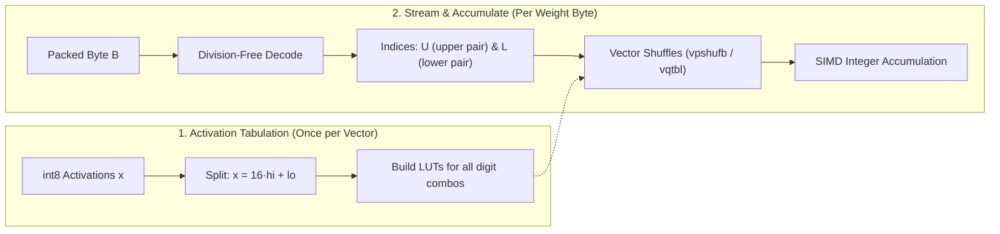

# Velurex Encoding

**A 1.60 bits-per-weight ternary representation engineered for division-free SIMD decoding.**

*Author:* Lukáš Velecký &bull; *Reference Implementation:* [`quintrit_core::pack`](../rust/crates/quintrit-core/src/pack.rs) &bull; *See [Citation](#6-citation)*

---

## 1. Overview & Mathematical Definition

In 1.58-bit neural network architectures, each ternary weight takes a value $t_k \in \{-1, 0, +1\}$. To eliminate sign-handling overhead during packing, each weight is first biased into a non-negative ternary digit:

$$d_k = t_k + 1 \quad \text{where} \quad d_k \in \{0, 1, 2\}$$

Five consecutive ternary digits $(d_0, d_1, d_2, d_3, d_4)$ are packed into a single 8-bit byte $B$ using the mixed-radix vector $(1, 3, 9, 28, 84)$:

$$B = d_0 + 3\,d_1 + 9\,d_2 + 28\,d_3 + 84\,d_4$$

The first three weights $(d_0, d_1, d_2)$ correspond to standard base-3 positional digits ($3^0, 3^1, 3^2$). The last two weights $(d_3, d_4)$ are scaled by $28$ and $84 = 28 \times 3$, rather than traditional powers of three ($27$ and $81$).

### Fundamental Properties

| Property | Value | Notes |
|:---|:---:|:---|
| **Valid input states** | **243** ($3^5$) | Exactly 5 ternary weights per byte |
| **Minimum byte value** | `0` | All $t_k = -1 \implies d_k = 0$ |
| **Maximum byte value** | `250` | $2 + 3(2) + 9(2) + 28(2) + 84(2) = 250$ |
| **Storage density** | **1.60 bpw** | 8 bits / 5 weights |
| **Theoretical entropy** | $1.585$ bpw | $\log_2(3)$ bits per ternary state |
| **Storage efficiency** | **99.1%** | $5 \cdot \log_2(3) / 8$ of total byte capacity utilized |
| **Forbidden byte range** | `251 … 255` | Never generated; provides zero-cost data corruption detection |

> [!NOTE]
> Out of 256 possible 8-bit values, exactly 243 are utilized. The radix 28 intentionally creates a deterministic one-byte gap after every group of 27 valid values (bytes `27`, `55`, `83`, etc., never occur in valid streams), and values `251 … 255` are unused. This structural gap incurs zero storage penalty—since storing five trits inherently requires 8 bits ($3^5 = 243 > 128$)—and forms the mathematical foundation of our division-free SIMD decoder.

---

## 2. Why Radix 28: Division-Free SIMD Decoding

Decompose the packed byte $B$ into lower and upper components:

$$B = L + 28 \cdot U$$

where:

$$\begin{aligned}
L &= d_0 + 3\,d_1 + 9\,d_2 &&\quad 0 \le L \le 26 \quad (\text{lower three digits}) \\
U &= d_3 + 3\,d_4          &&\quad 0 \le U \le 8  \quad (\text{upper two digits})
\end{aligned}$$

Because $L_{\max} = 2 + 6 + 18 = 26 < 28$, the upper component $U$ is strictly the integer quotient and $L$ is the remainder:

$$U = \left\lfloor \frac{B}{28} \right\rfloor \qquad L = B - 28 \cdot U$$

### The Algebraic Insight

If standard base-3 powers $(1, 3, 9, 27, 81)$ were used, separating the groups would require dividing by 27. However:
- Integer division and modulo by 27 do not exist in SIMD instruction sets (AVX2, AVX-512, ARM NEON).
- Emulating division by 27 across vector lanes requires multi-instruction multiplication with large magic constants and wide bit shifts, introducing register pressure and pipeline latency.

By choosing **28 instead of 27**, we exploit the factorization:

$$28 = 4 \times 7$$

Because $\frac{1}{7} \approx \frac{1}{8}\left(1 + \frac{1}{8}\right) = \frac{9}{64}$, dividing by 28 can be evaluated with mathematical exactness across all 243 states using only elementary bit shifts and a single **rounding byte average**:

```text
v11 = B >> 2                               // B / 4
v15 = v11 >> 3                              // B / 32
v17 = (v11 + v15 + 1) >> 1                  // Rounding unsigned byte average: ((v11 + v15 + 1) / 2)
U   = v17 >> 2                              // Final quotient: floor(B / 28)
```

> [!TIP]
> The expression `(v11 + v15 + 1) >> 1` corresponds directly to native single-cycle hardware instructions present in all major SIMD architectures:
> - **x86-64 (AVX2 / AVX-512):** `_mm256_avg_epu8` (`vpavgb`)
> - **AArch64 (ARM NEON):** `vrhadd_u8` / `vrhaddq_u8`
>
> On AVX-512 with VBMI, decoding is even faster: since $28$ is a multiple of $4$, $\lfloor B / 28 \rfloor = \lfloor (B \gg 2) / 7 \rfloor$. The quotient and table offsets are resolved in just 4 uops using vector byte permutations (`vpermb`).

Exhaustive testing across all $0 \le B \le 250$ verifies that this sequence reproduces $\lfloor B / 28 \rfloor$ with **100% bit-exact accuracy**. The decoder requires **zero hardware integer division and zero modulo instructions**.

---

## 3. High-Throughput GEMV: From Digits to Dot Product

In autoregressive inference, matrix-vector multiplication (GEMV) multiplies ternary weights by activation vectors:

$$y_j = \sum_{i} w_{ji} \cdot x_i \quad \text{where} \quad w_{ji} \in \{-1, 0, +1\}$$

Because ternary weights act as selectors rather than multipliers, Quintrit converts arithmetic into a fused **two-stage Look-Up Table (LUT)** process:



### 1. Tabulate Once per Activation Vector
For each column group, all possible partial sums that digit combinations can form (e.g., $t_3 a_3 + t_4 a_4$ across all 9 possible combinations of $U$) are precomputed and cached in vector registers. The construction cost is amortized across all rows in the weight matrix.

### 2. Stream & Shuffle per Weight Matrix
Each weight byte is decoded in SIMD into table indices $(U, L)$. Vector permute instructions (`vpshufb` on AVX2, `vpermb` on AVX-512, `vqtbl` on ARM NEON) extract the precomputed partial sums simultaneously across 32 or 64 matrix rows.

### Full-Range Exactness
To preserve precision across the full range of `int8` activations ($[-128, 127]$), activations are split into small balanced components:

$$x = 16 \cdot \text{hi} + \text{lo} \quad \text{where} \quad \text{lo} \in [-8, 7], \quad \text{hi} \in [-8, 8]$$

Both parts share the identical decoded weight indices, and partial products are fused as $\text{lo} + 16 \cdot \text{hi}$. The resulting integer dot products are mathematically exact with zero rounding or approximation. For detailed kernel implementations and instruction set dispatch, see [`kernels.md`](kernels.md).

---

## 4. Format Comparison

| Format | Trits / Byte | Bits / Weight | Storage Reduction vs. `I2_S` | Scale Storage | Decoding Complexity |
|:---|:---:|:---:|:---:|:---|:---|
| **Microsoft `I2_S`** *(BitNet)* | 4 | 2.00 bpw | Baseline (0.0%) | 1 per tensor | Bit-slicing / planar MAD |
| **`TQ2_0`** *(GGUF type 35)* | 4 | 2.0625 bpw | $-3.1\%$ (larger) | Block scale (66B / 256w) | 2-bit lookup |
| **`TQ1_0`** *(GGUF type 34)* | 5 | 1.6875 bpw | $+15.6\%$ | Block scale (54B / 256w) | Base-3 division / unpack |
| **Velurex Encoding** *(Quintrit)* | **5** | **1.60 bpw** | **$+20.0\%$** | 1 per tensor | **Division-free SIMD ALU / LUT** |
| *Shannon Entropy Limit* | — | 1.585 bpw | $+20.7\%$ | — | Theoretical bound ($\log_2 3$) |

### Key Takeaways:
- **Exact 20.0% Bandwidth Reduction:** Compared to `I2_S`, weight streaming traffic drops from 250 MB to 200 MB per billion parameters per token.
- **5.2% Denser than `TQ1_0`:** Avoids the per-block scale overhead and base-3 decoding penalties of `TQ1_0`.
- **Hardware-Native:** Directly matches the 32-row and 64-row SIMD execution widths on modern server and edge processors. For empirical bandwidth measurements, see [`benchmarks.md`](benchmarks.md).

---

## 5. Reference Implementation

The canonical implementation is part of the [`quintrit-core`](../rust/crates/quintrit-core) crate:

- **Group Packing:** [`quintrit_core::pack::pack_5trits`](../rust/crates/quintrit-core/src/pack.rs)
- **Decoding LUT:** [`quintrit_core::pack::BYTE_TO_TRITS`](../rust/crates/quintrit-core/src/pack.rs) (maps all 256 byte values; forbidden bytes `251 … 255` decode safely to zeros)
- **Matrix Packing:** [`quintrit_core::pack::pack_matrix`](../rust/crates/quintrit-core/src/pack.rs) (160-trit planar blocks)
- **Tiled SIMD Transform:** [`quintrit_core::lut::transform_weights_lut`](../rust/crates/quintrit-core/src/lut.rs) (arranges weights into 32-row and 64-row cache-aligned execution tiles; see [`architecture.md`](architecture.md))

---

## 6. Citation

If you incorporate Velurex encoding or Quintrit into academic research or software projects, please cite:

```bibtex
@misc{velecky2026velurex,
  author       = {Velecký, Lukáš},
  title        = {Velurex Encoding: A 1.60 Bits-Per-Weight Ternary Representation for Division-Free SIMD Inference},
  year         = {2026},
  howpublished = {\url{https://github.com/velurex-labs/quintrit}},
  note         = {Part of the Quintrit project}
}
```

Metadata is also available in [`CITATION.cff`](../CITATION.cff).
